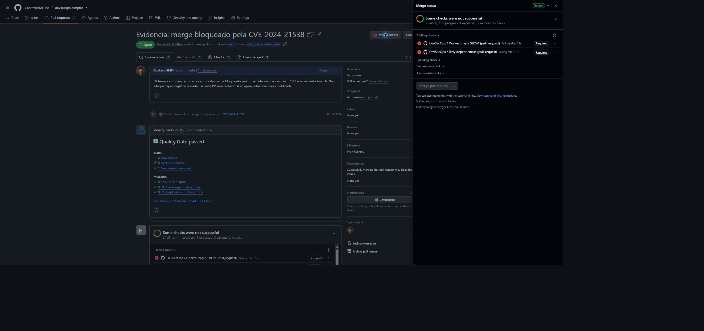
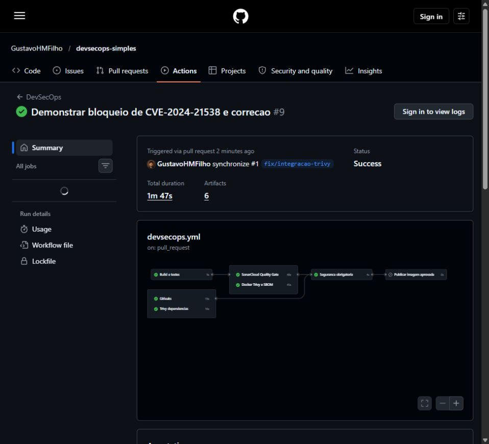
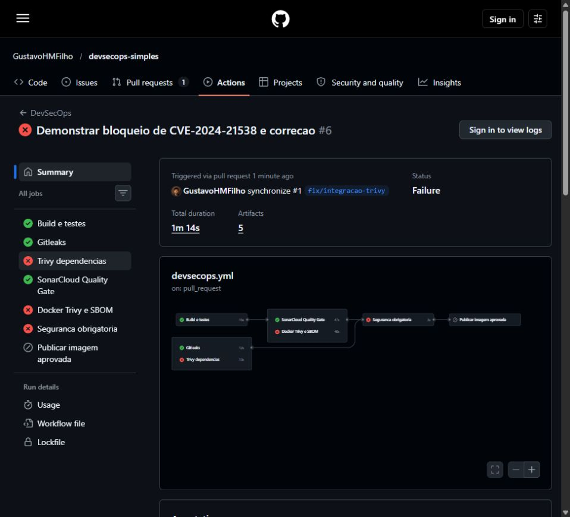

# Evidências do pipeline DevSecOps

**Aluno:** Gustavo Henrique Moraes Filho  
**Matrícula:** 202310429  
**Disciplina:** DevOps - UFLA

## Links das execuções

| Evidência | Link |
|---|---|
| Repositório | https://github.com/GustavoHMFilho/devsecops-simples |
| PR com falha e correção | https://github.com/GustavoHMFilho/devsecops-simples/pull/1 |
| Falha isolada pela CVE | https://github.com/GustavoHMFilho/devsecops-simples/actions/runs/40611844168 |
| Aprovação após correção | https://github.com/GustavoHMFilho/devsecops-simples/actions/runs/40612244995 |
| Publicação na main | https://github.com/GustavoHMFilho/devsecops-simples/actions/runs/40612509002 |
| PR para captura do merge bloqueado | https://github.com/GustavoHMFilho/devsecops-simples/pull/2 |
| Execução da captura | https://github.com/GustavoHMFilho/devsecops-simples/actions/runs/40613013758 |

## Bloqueio e correção

O commit `28a33a9` contém cross-spawn 7.0.3. O Trivy identifica
CVE-2024-21538, HIGH, com correção disponível em 7.0.5/6.0.6. O commit
`031981e` atualiza para 7.0.6. A execução final `40612244995` aprova todos
os checks. O PR #1 foi integrado somente após essa aprovação.

O estado `BLOCKED` está em [pr-bloqueado.json](evidencias/pr-bloqueado.json).
O PR #2 foi utilizado para a captura do botão de merge desabilitado e fechado
sem integrar a versão vulnerável. Nenhuma imagem vulnerável foi publicada.

## Capturas

## Relatórios e SBOM

- [Relatório Trivy da dependência vulnerável](evidencias/demonstracao-final/dependencies.json)
- [Trecho do primeiro relatório com a CVE](evidencias/falha/cve-resumo.json)
- [Proteção da branch main](evidencias/protecao-main.json)
- [SBOM da imagem aprovada em SPDX JSON](evidencias/sbom-aprovado.spdx.json)

O SBOM foi gerado pelo Syft e baixado do artifact da execução aprovada
`40611680339`. A execução final e a publicação na main também disponibilizam
os respectivos SBOMs na seção Artifacts do GitHub Actions.

## Publicação

Imagem: `ghcr.io/gustavohmfilho/devsecops-simples:f61bbda2b968238f0294f0fad1a3f26e3936ccf7`.

Digest confirmado no log de publicação:
`sha256:0892c89b2f110e9bc4fb047825ed5953aea7c161fb0c7b733882f28d5ba17ef8`.
